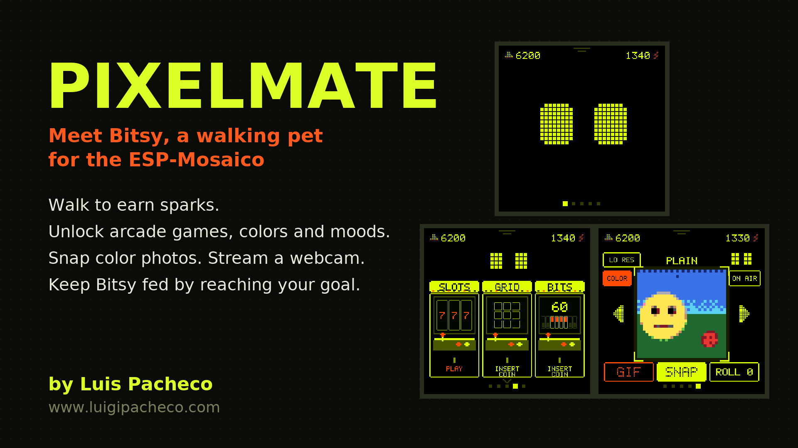
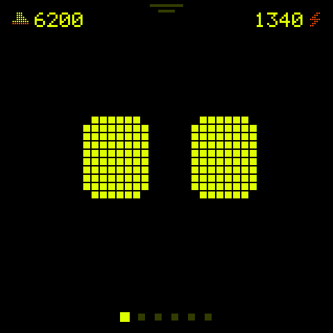
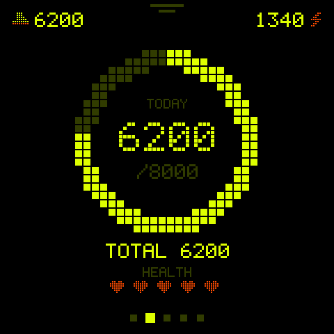
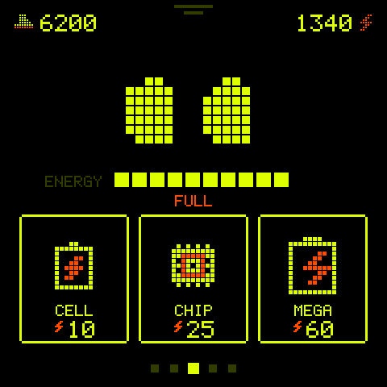
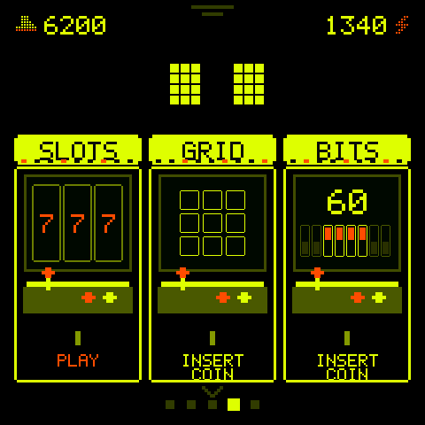
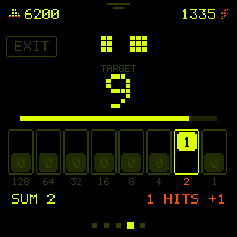
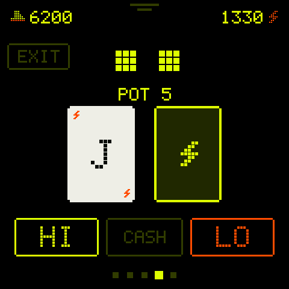
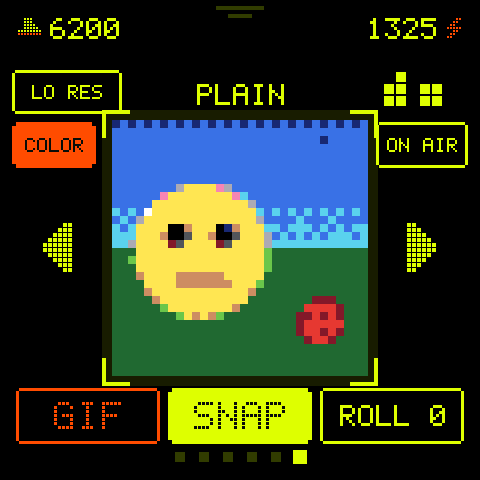
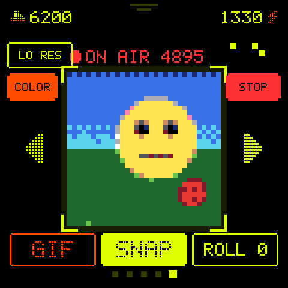
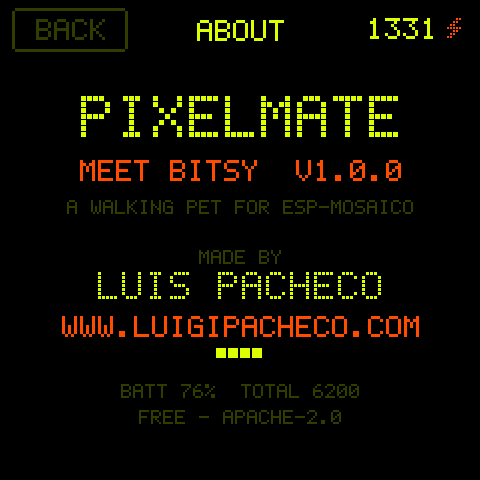

# PixelMate: meet Bitsy, a walking pet

**PixelMate** turns your ESP-Mosaico into **Bitsy**, a pixel-art robot pet that
lives on your steps. Walk and Bitsy gets fed; skip a day and it gets hungry.
Every 20 steps earns a **spark**, and sparks buy everything else: eye colors,
pixel styles, moods, arcade games, a photo booth and even a Wi-Fi webcam.

It is inspired by the pocket step-counter pets of the '90s, with an original
character: just a pair of expressive pixel eyes.

Made by **Luis Pacheco**: [www.luigipacheco.com](https://www.luigipacheco.com)

## What you can do

| | |
|---|---|
|  | **Bitsy** reacts to everything: blinks, follows your finger, gets happy, sleepy, hungry or grumpy. |
|  | **Steps ring** with today's progress, your all-time total and Bitsy's health (5 hearts). The BMI270's own step counter keeps counting while the screen sleeps. |
|  | **Feed** Bitsy snacks with sparks. To stay healthy it needs half your daily goal in steps; a missed day costs a heart. |
|  | **Arcade** of pixel cabinets, unlocked in order: Spark Slots, Spark Stack, Spark Grid, Bit Flip, Bitsy Says and HI-LO. Each costs a few sparks a play. |
|  | **Bit Flip**: set eight switches to the target number in binary before the timer runs out. |
|  | **HI-LO**: double or nothing. Guess whether the next card is higher or lower, and cash out before you lose it all. |
|  | **Photo booth** (needs the camera module): low-res photos and GIFs with retro looks (dither, scanlines, game-green, thermal, ASCII, halftone, glitch, edges, pop, mirror, CRT) and **COLOR FILM**. Plug the camera in or out at any time. |
|  | **Wi-Fi webcam**: tap ON AIR and watch Bitsy's camera in a browser, or bring it into Zoom/Meet through OBS's virtual camera. |
|  | **Settings**: volume, daily goal, Wi-Fi, screen sleep, brightness, about and reset. |

Plus a **stats web page** on your network (`http://pixelmate.local`) with
today's steps, battery and the photo booth gallery.

## Hardware

- ESP-Mosaico (ESP32-S31) with its 480×480 touch screen, BMI270 IMU and speaker.
- Optional: the camera module in the left slot, for the photo booth and webcam.
- Battery recommended: PixelMate shows the charge, dims and sleeps to save power.

## Getting started

1. Install PixelMate from Mosaico Ideas and open it.
2. Walk! Sparks arrive as you go (20 steps = 1 spark). Pull down from the top
   edge for the menu: STORE, STYLE and SETTINGS.
3. Swipe left and right between Bitsy, the steps ring, feeding, the arcade and
   (with the camera plugged in) the photo booth.
4. Optional Wi-Fi: PixelMate uses the board's saved Wi-Fi. To set up a new
   network, open **Settings → Wi-Fi → SET UP**, join the `PIXELMATE-XXXX`
   hotspot from your phone and pick your network. Then open
   `http://pixelmate.local`.

### Webcam

Buy **WEBCAM** in the store, open the photo booth and tap **ON AIR**. The
screen shows a 4-digit code; open `http://pixelmate.local:81/cam?k=CODE` on a
computer on the same network. For Zoom or Meet, add that address to OBS
Studio as a Media Source (or Browser source), click **Start Virtual Camera**,
and pick **OBS Virtual Camera** in your call app. The stream is small and
retro (about 10 frames a second), and it only runs while ON AIR is lit.

## Good to know

- The pet saves to the board's storage and survives restarts.
- Daily health needs the real date, which comes from Wi-Fi time sync.
- Anyone on your Wi-Fi network can open the stats page and photo gallery; the
  webcam always needs the code shown on the screen.
- Version 1.0.0 was developed and tested on one ESP-Mosaico board and in the
  host simulator.

## Coming next

- **Pan & tilt module**: give Bitsy a neck, so the webcam can look around.
- More mini games and moods.
- Bitsy as a voice assistant, using the board's microphone and AI button.

Follow along at [www.luigipacheco.com](https://www.luigipacheco.com).

## License

PixelMate is free software by Luis Pacheco, released under the
[Apache License 2.0](https://www.apache.org/licenses/LICENSE-2.0); keep the
NOTICE file with any copy or fork. Some files come from Espressif's
ESP-Mosaico application template and keep their own license header. The
store images use the DejaVu fonts (free license).
